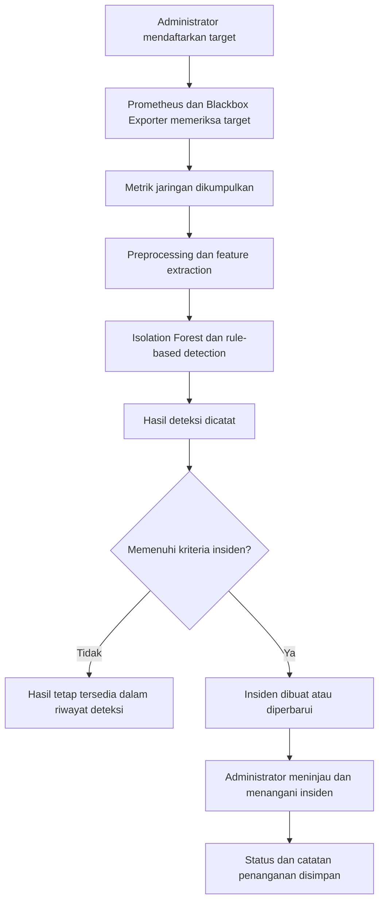

# MONETA — Monitoring Network Anomalies

**Sistem monitoring jaringan dengan deteksi anomali berbasis kecerdasan buatan.**

MONETA adalah aplikasi web untuk membantu administrator memantau ketersediaan dan performa perangkat atau layanan jaringan, mengenali pola metrik yang tidak biasa, serta mengelola indikasi gangguan melalui proses penanganan insiden yang terdokumentasi.

## Latar Belakang

Ketersediaan jaringan dan layanan digital berpengaruh langsung terhadap aktivitas operasional organisasi. Gangguan seperti latency yang meningkat, koneksi yang tidak stabil, atau layanan yang tidak dapat diakses dapat menghambat aktivitas pengguna. Dalam banyak situasi, administrator perlu memeriksa metrik dan kondisi jaringan secara manual untuk memahami kapan suatu gangguan mulai terjadi dan seberapa besar dampaknya.

Monitoring konvensional umumnya mengandalkan metrik dan ambang batas statis. Pendekatan tersebut berguna untuk mengenali kondisi yang sudah melewati batas tertentu, tetapi dapat melewatkan perubahan pola yang tidak biasa ketika nilainya belum melampaui ambang batas tersebut.

MONETA dikembangkan untuk melengkapi proses monitoring tersebut dengan analisis anomali berbasis AI. Sistem menggabungkan pengumpulan metrik jaringan, deteksi berbasis aturan, analisis pola menggunakan machine learning, visualisasi, dan manajemen insiden dalam satu aplikasi.

## Tujuan

MONETA bertujuan untuk:

- Memantau ketersediaan dan performa perangkat atau layanan jaringan dari satu dashboard.
- Mengumpulkan metrik jaringan secara berkala dan menyediakan riwayatnya untuk ditinjau.
- Mengenali pola metrik yang menyimpang dari kondisi normal melalui deteksi anomali berbasis AI.
- Melengkapi deteksi AI dengan aturan untuk kondisi yang kriterianya dapat ditentukan secara eksplisit.
- Menyediakan informasi dan bukti metrik yang membantu administrator memeriksa indikasi gangguan.
- Mengelola insiden, perubahan status, catatan pemeriksaan, dan hasil penanganannya.
- Mengevaluasi hasil deteksi melalui skenario pengujian terkontrol.

## Cakupan Monitoring

MONETA berfokus pada **ketersediaan dan performa jaringan**, bukan inspeksi seluruh aktivitas jaringan.

Jenis pemeriksaan yang diprioritaskan pada MVP:

- **ICMP** untuk memeriksa keterjangkauan target.
- **HTTP/HTTPS** untuk memeriksa ketersediaan dan waktu respons endpoint layanan web.

Metrik yang menjadi perhatian meliputi status keberhasilan pemeriksaan, latency atau waktu respons, serta kegagalan probe. Data tersebut digunakan untuk melihat kondisi target dari waktu ke waktu dan menjadi masukan bagi proses deteksi anomali.

Pengujian diawali pada lingkungan simulasi dengan skenario gangguan terkontrol, misalnya peningkatan latency, packet loss, dan layanan yang tidak tersedia. Pengujian pada jaringan nyata hanya dilakukan terhadap target yang telah memperoleh izin. Target awal pengujian direncanakan sekitar 5–15 perangkat atau layanan.

## Cara Kerja MONETA

Secara umum, MONETA menjalankan alur berikut:

1. **Pendaftaran target** — Administrator menambahkan perangkat atau layanan yang diizinkan untuk dipantau, beserta alamat, jenis pemeriksaan, interval, dan timeout.
2. **Pengumpulan metrik** — Prometheus dan Blackbox Exporter melakukan pemeriksaan berkala dan mengumpulkan metrik ketersediaan serta waktu respons target.
3. **Pembentukan fitur** — Layanan analisis mengambil data metrik dalam rentang waktu tertentu, melakukan preprocessing, lalu membentuk fitur yang mewakili perilaku target. Contohnya rata-rata latency, latency maksimum, variasi latency, dan tingkat keberhasilan pemeriksaan.
4. **Deteksi kondisi tidak biasa** — Isolation Forest menganalisis pola metrik untuk menemukan penyimpangan dari pola umum. Pada saat yang sama, rule-based detection memeriksa kondisi yang memiliki kriteria eksplisit, seperti target tidak dapat diakses atau latency melewati batas yang ditentukan.
5. **Pencatatan hasil deteksi** — Hasil analisis disimpan bersama informasi target, waktu analisis, model yang digunakan, skor anomali jika tersedia, dan fitur yang mendukung hasil tersebut.
6. **Pembentukan atau pembaruan insiden** — Hasil yang memenuhi kriteria insiden dihubungkan dengan insiden terkait. Sistem menggunakan identitas deduplikasi agar deteksi berulang untuk kejadian yang sama tidak terus-menerus membuat insiden baru.
7. **Pemeriksaan administrator** — Administrator meninjau target, waktu kejadian, metrik pendukung, dan hasil deteksi, kemudian mencatat tindakan serta memperbarui status insiden.

## Fitur Utama

### Dashboard Monitoring

Menyajikan ringkasan kondisi target, status ketersediaan, grafik historis, dan informasi hasil deteksi agar administrator dapat melihat kondisi jaringan secara terpusat.

### Manajemen Target

Menyediakan pengelolaan target monitoring, termasuk menambah, melihat, mengubah, mengaktifkan, dan menonaktifkan target yang telah diizinkan.

### Pengumpulan dan Riwayat Metrik

Mengumpulkan metrik pemeriksaan secara berkala dan menyediakan riwayat yang relevan untuk melihat perubahan performa serta menelusuri kondisi sebelum dan sesudah gangguan.

### Deteksi Anomali Berbasis AI

Menggunakan **Isolation Forest** sebagai model awal untuk mengenali pola metrik yang menyimpang dari pola umum. Hasilnya dilengkapi informasi skor dan fitur yang relevan untuk membantu proses pemeriksaan.

### Rule-Based Detection

Memeriksa kondisi yang dapat ditentukan secara eksplisit, misalnya target tidak dapat diakses atau latency melampaui ambang batas. Metode ini juga menjadi pembanding atau baseline dalam evaluasi model AI.

### Manajemen Insiden

Menyediakan daftar dan detail insiden, tingkat keparahan, status penanganan, waktu kejadian, serta catatan pemeriksaan. Deteksi berulang untuk kejadian yang sama dapat dikorelasikan agar daftar insiden tidak dipenuhi duplikasi.

### Riwayat dan Notifikasi

Menyimpan perubahan status dan catatan penanganan sebagai jejak aktivitas. Notifikasi direncanakan untuk insiden yang memenuhi kriteria yang ditetapkan dalam MVP.

## Deteksi dan Pengelolaan Insiden

MONETA membedakan **hasil deteksi** dengan **insiden**. Setiap proses analisis menghasilkan catatan deteksi, tetapi tidak setiap hasil deteksi harus menjadi insiden. Hasil yang tidak menunjukkan anomali atau belum memenuhi kriteria insiden tetap dapat disimpan sebagai riwayat analisis.

Ketika suatu hasil memenuhi kriteria pembentukan insiden, sistem menghubungkannya dengan insiden yang sesuai. Identitas deduplikasi (*fingerprint*) digunakan untuk mengenali kejadian yang sama. Deteksi berulang dapat memperbarui waktu terakhir terdeteksi dan jumlah deteksi pada insiden tersebut, alih-alih membuat insiden duplikat.

Status insiden yang digunakan:

| Status | Makna |
|---|---|
| `OPEN` | Insiden baru yang menunggu pemeriksaan. |
| `INVESTIGATING` | Insiden sedang diperiksa atau ditangani administrator. |
| `RESOLVED` | Penanganan telah selesai. |
| `IGNORED` | Insiden tidak perlu ditindaklanjuti atau dinyatakan sebagai false alarm. |

Setiap perubahan status maupun penambahan atau perubahan catatan dapat dicatat sebagai riwayat kejadian (*incident event*) beserta aktor dan waktunya.

## Informasi yang Dikelola

Secara konseptual, data aplikasi MONETA mencakup beberapa kelompok berikut:

- **Pengguna** — akun administrator yang mengakses dan mengelola sistem.
- **Target monitoring** — identitas perangkat atau layanan, alamat, jenis probe, interval, timeout, dan status monitoring.
- **Hasil deteksi** — target yang dianalisis, model dan versinya, status anomali, skor anomali, fitur hasil ekstraksi, serta rentang waktu data yang dianalisis.
- **Insiden** — target terkait, ringkasan kejadian, jenis dan tingkat keparahan, status, identitas deduplikasi, serta waktu pertama dan terakhir terdeteksi.
- **Riwayat insiden** — aktor, jenis peristiwa, perubahan status, catatan pemeriksaan, dan waktu aktivitas.

Metrik jaringan bersifat time-series dan dikelola oleh Prometheus. PostgreSQL digunakan untuk menyimpan data aplikasi, konfigurasi target, hasil deteksi, insiden, dan metadata penanganannya.

## Teknologi Inti

| Komponen | Teknologi | Peran dalam MONETA |
|---|---|---|
| Dashboard web | React, TypeScript | Menampilkan status target, metrik, hasil deteksi, dan insiden. |
| Backend aplikasi | Node.js, Express.js | Menangani autentikasi, API, manajemen target, dan pengelolaan insiden. |
| Database aplikasi | PostgreSQL | Menyimpan pengguna, target, hasil deteksi, insiden, dan riwayatnya. |
| Network monitoring | Prometheus, Blackbox Exporter | Memeriksa target dan mengumpulkan metrik jaringan. |
| Analisis anomali | Python, pandas, NumPy, scikit-learn | Melakukan preprocessing, feature extraction, deteksi, dan evaluasi model. |
| Model awal | Isolation Forest | Mengidentifikasi pola metrik yang menyimpang dari pola umum. |

---

MONETA dikembangkan sebagai proyek sistem monitoring jaringan yang menggabungkan observabilitas metrik, deteksi anomali, dan pengelolaan insiden agar administrator memperoleh gambaran kondisi jaringan yang lebih terstruktur dan dapat ditindaklanjuti.
